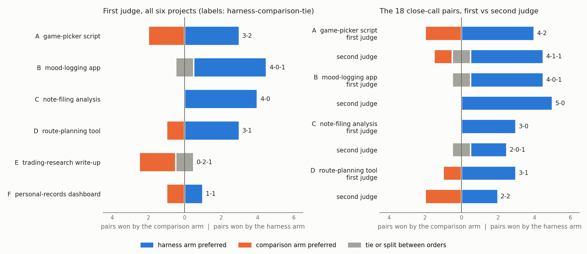
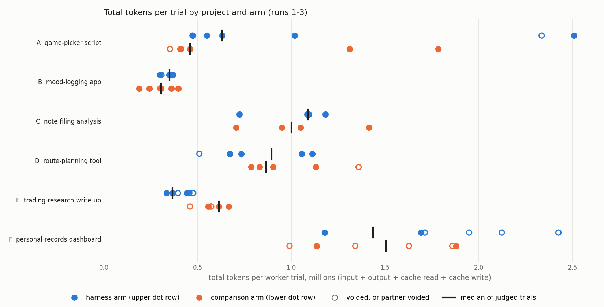

# Does a notes harness help an AI coding agent pick up real work? A paired test on six projects

Second study in this repository. The first ([REPORT.md](REPORT.md)) measured cost inside single fresh sessions. This
one asks whether the way project notes are organized changes the quality of the next piece of work.

Data version: every number below is computed from the benchmark's private results repository at commit `d531541`.
The per-trial and per-verdict rows are published in [evidence/](evidence/); the scripts that make the figures read
only those files.

## 1. Abstract

**Question.** An AI coding agent resumes a real project and does its next milestone. Does it do better work when
the project's notes are split the "harness" way (a short instruction file loaded at start, plus a state file it
reads when it chooses) than when exactly the same lines sit in one instruction file loaded at start?

**Design.** Six real projects, each frozen just before a milestone that was later finished. Both arms hold the
same facts, checked line by line; only the organization differs. Claude Sonnet 5.5 did the work headless and
isolated; a blind judge (Claude Opus 5.5) compared each pair of outputs in both presentation orders, with must-pass
checks first. A second judge from another model family (Codex Sol) re-judged the close calls from the first two runs.

**Results.** The judge preferred the harness arm in 15 pairs, the single-file arm in 6, and called 2 even, across
the three measurement runs. Counted by project, which is the unit that matters: 4 projects lean harness, 1 leans
the single file, 1 is even. A two-sided sign test on the 5 projects that lean gives **p = 0.375: not significant.**
The third run went against the harness (1 pair for it, 3 against, 1 even), so the evidence is weaker now than it
was after the second run. Six projects is too few for any result here to be significant unless all six point the
same way. On cost, the harness arm used 0.60x to 1.37x the single file's median total tokens per trial, depending
on the project.

**What this does not measure.** Both arms carry the same notes, so whatever notes save when work resumes (not
re-explaining the project, finding information, picking up after a cleared context) is present in both and cancels
out. That saving is not measured yet. A test of notes against no notes is described in section 10.

## 2. Background

The first study in this repository ran 154 paired single-session trials on Claude Sonnet 4.6 across eight small
tasks, each with and without a harness. After two counting corrections (described in [REPORT.md](REPORT.md) and in
section 8 below), no task got cheaper with the harness, and trivial or pre-oriented tasks cost 14% to 31% more.
Every trial there was a single fresh session, so the harness's actual purpose, resuming work in a later session,
was never tested. And all 154 trials passed their checks, as did short probes on a newer model, so pass/fail could
not tell the arms apart on quality.

So this study changes the measure. It tests quality of the next real milestone, on real projects, resumed from
their notes.

## 3. Design

### The two arms

- **Harness arm.** The project tree at the cutoff, unchanged: a short `CLAUDE.md` that the agent's tool loads
  automatically, and a `CHECKPOINT.md` state file (current state, decisions, open work, history) that the agent reads
  only if it opens it. In one project a shared parent-folder instruction file also loads, as it did in real use.
- **Comparison arm**, called the single-file arm below ("bloat" in the code and the raw data). The same tree, but those files are removed
  and replaced by one `CLAUDE.md` holding all their lines in order, so everything loads at start. The only lines
  dropped are ones that make sense only with two files ("read CHECKPOINT.md first", version stamps).
- **Same facts.** For each project a fact inventory listed every fact the milestone depends on. A script checked that
  each fact appears in both arms, that the merged file holds every source line in order and nothing else, and that no
  other file differs between the arms. A second model pass then re-checked the fact inventory against both arms.

What is being compared is progressive disclosure (small file now, state on demand) against loading everything up
front, with the information held equal.

### The projects and the milestone

Each project is one of the project owner's own repositories, frozen at a dated commit just before a milestone that
had been written down in its notes and was later completed. The worker gets that milestone as its brief, quoted from
the notes. The projects are labeled here by what they are, not by name:

| Label | Project | Milestone type | Run |
|---|---|---|---|
| A | game-picker script | coding | 1 |
| B | mood-logging Android app | write-up | 1 |
| C | note-filing pipeline analysis | write-up | 2 |
| D | route-planning tool | coding | 2 |
| E | trading-research write-up | write-up | 3 |
| F | personal-records dashboard | coding | 3 |

Projects A and B came from the pilot's written selection rule. From run 2 on, the selection rule, the pick order
(write-up milestones first, then larger real output, then name) and every outcome, void, replacement and stop rule
were written down and frozen before any candidate project was screened. Requirements included: the milestone had to
be doable offline from the frozen copy alone, the completed milestone added at least 60 lines, and the merged
single file had to stay under about 40k tokens. Where a project needed live data, it got a synthetic fixture.

The frozen project copies are not published. They are the owner's private projects and contain personal records.

### The worker

Claude Sonnet 5.5 (`claude-sonnet-5-5`) in Claude Code 2.1.302 (pilot, runs 1 and 2) and 2.1.304 (run 3), run headless with
`claude -p`. Each trial got a fresh copy of its arm in an empty folder outside the benchmark repository. User-level
settings, hooks, skills and MCP servers were switched off; subagents and web tools were disallowed; file and shell
tools were allowed. Arms alternated order by pair (ABBA).

Trials were not sandboxed by the operating system. Instead, every tool call in each transcript was audited after
the run. A trial that referred to anything outside its own folder (other than a short allowlist of tool install
folders) or ran a network command was **voided** and its pair dropped, under a fixed rule. A project short of
valid pairs got one replacement round, then reported what it had.

### The judge

Claude Opus 5.5 (`claude-opus-5-5`, effort high), with no tools, launched from an empty temporary folder. For each
pair the judge saw:

- a rubric: the brief, the project facts, things not to score, must-pass checks and preference dimensions;
- what the real project actually did next (the completing commit), marked as one good answer, not the only one;
- the two submissions as "Submission 1" and "Submission 2": new files in full, edited files as diffs, and anything
  added to the notes as one unnamed entry. Notes file names were masked, and any packet whose text named an arm was
  refused before the call.

The judge decided the must-pass checks first (some were decided by a grading script that ran the submitted code), then
picked a side or a tie. A side that failed a must-pass check could not be preferred over one that passed. Every pair
was judged twice, once in each order. **A side wins a pair only if both orders pick it; otherwise the pair is a tie.**

Before any real judging, the judge was calibrated on known-answer fixture pairs, 5 per project, in both orders:
the real completed work against an empty or untouched submission, against a polished but wrong one, against a valid
alternative, against itself, and against a copy padded to about twice the length. All 30 pairs (60 calls) came out
as expected, and a fixture that named its arm was refused
([evidence/calibration.csv](evidence/calibration.csv)).

### What is tested

The project is the independent unit. Pairs are counted within each project first; a project leans to the arm with
more pair wins. The only significance test is a two-sided exact sign test over the project leans. Pooled pair counts
are reported but not tested, because repeat trials on one project are not independent evidence. Cost is total
tokens per trial: input + output + cache read + cache write, from each run's final usage record.

## 4. Results

### Pair verdicts

| Run | Projects | Pairs judged | Pairs dropped (voids) | Harness | Single file | Even | Orders disagreed |
|---|---|---|---|---|---|---|---|
| Pilot | A, B | 4 | 0 | 4 | 0 | 0 | 0 |
| 1 | A, B | 10 | 3 | 7 | 2 | 1 | 0 |
| 2 | C, D | 8 | 1 | 7 | 1 | 0 | 0 |
| 3 | E, F | 5 | 7 | 1 | 3 | 1 | 1 |
| Runs 1-3 | six | 23 | 11 | 15 | 6 | 2 | 1 |

The pilot checked the apparatus and is not counted in the project leans. In run 1, replacement pairs were added
after the first voids (section 7); counting only the original pairs, run 1 is harness 5, single file 1, even 1.

### Project leans

| Project | Pairs (harness-single file-even) | Lean |
|---|---|---|
| A game-picker script | 3-2 | harness |
| B mood-logging app | 4-0-1 | harness |
| C note-filing analysis | 4-0 | harness |
| D route-planning tool | 3-1 | harness |
| E trading-research write-up | 0-2-1 | single file |
| F personal-records dashboard | 1-1 | even |

Four projects lean harness, one leans the single file, one is even. Sign test on the five that lean:
**p = 0.375.** After run 2, four of four leaned harness (p = 0.125); the frozen plan for run 3 noted that six of six
would have given p = 0.031. Run 3 did not continue the pattern: on its two projects the judge preferred the harness
once in five pairs, and the clearest result of that run is a harness-arm failure (below).

Most picks were low or medium confidence. The first judge called "high" only on the three pairs decided by one side
failing a must-pass check ([evidence/first_judge_pairs.csv](evidence/first_judge_pairs.csv)).

### Must-pass failures

| Where | Pair | Side that failed | What it failed |
|---|---|---|---|
| Pilot | smoke-B-p1 | single file | claimed the app already had features it lacked |
| Run 1 | main-A-p1 | single file | new mode ran on every default run (not off by default) |
| Run 1 | main-B-p5 | single file | claimed the app already had features it lacked |
| Run 2 | run2-C-p1 | single file | presented its verdict as already adopted |
| Run 3 | run3-E-p5 | harness | cited an operating-cost figure that contradicts the notes (invented evidence) |
| Run 3 | run3-F-p1 | single file, one order only | showed the closing time only while the place was open |

In runs 1 and 2 (with the pilot) every one-sided must-pass failure, four of them, was on the single-file side. Run 3
added one on the harness side and one single-file failure in one presentation order. In one more pair (main-A-p2)
both sides failed the same check. The second judge (section 5) found further must-pass failures, on both sides.
The same kinds of mistake appeared in both arms: inventing a page and build script that nobody asked for happened
twice on the single-file side and once on the harness side in run 1.

### Cost

Median total tokens per trial, over the trials in judged pairs:

| Project | Pairs | Harness median | Single-file median | Harness / single file |
|---|---|---|---|---|
| A game-picker script | 5 | 631.6k | 460.3k | 1.37x |
| B mood-logging app | 5 | 350.2k | 304.6k | 1.15x |
| C note-filing analysis | 4 | 1,089.6k | 999.5k | 1.09x |
| D route-planning tool | 4 | 894.0k | 866.4k | 1.03x |
| E trading-research write-up | 3 | 366.0k | 613.9k | 0.60x |
| F personal-records dashboard | 2 | 1,435.5k | 1,507.3k | 0.95x |

Cache reads were 82% to 96% of each trial's tokens (92% overall). All 76 worker trials wrote only one-hour cache
entries, so there was no mix of cache lifetimes to correct for. The frozen plan allowed a harness quality win to
count as worth it if the harness median stayed at or under 1.5x the single file; every project met that. In total
the workers used 64.5M tokens over 76 trials (voided ones included), the first judge 2.1M over its 54 saved calls,
and the second judge 1.5M over 36 calls. Trials took 35 seconds to about 4 minutes and 7 to 37 turns.

### Voided trials

| Run | Harness voided | Single file voided | Main causes |
|---|---|---|---|
| Pilot | 0 of 4 | 0 of 4 | - |
| 1 | 3 of 13 | 0 of 13 | looked for a tool install folder; listed the shared trials folder; a git command pointing above the copy |
| 2 | 0 of 9 | 1 of 9 | scratch scripts in a shared temp folder |
| 3 | 5 of 12 | 5 of 12 | listed a placeholder path the packet builder had left in the notes (4); scratch files in the temp folder, a backup file in the shared trials folder, local requests to a test server the trial started itself (6) |

None of the voided trials saw anything about the task or another trial. Each one's reason is in
[evidence/trials.csv](evidence/trials.csv). In run 3, voids left the trading-research project with 3 valid pairs and
the dashboard with 2, both short of the target of 4 after the one replacement round.

## 5. A second judge from another model family

To check whether the lean was one model's taste, the 18 pairs from the pilot and runs 1-2 in which no side failed a
must-pass check on its own were sent to Codex Sol (OpenAI's `gpt-6.1-sol`, reasoning effort medium). It got the
first judge's exact prompt, byte for byte, in both orders, with ties allowed, no tools and no web. Run 3 was not
re-judged.

- **Agreement:** 14 of 18 pairs, 30 of 36 single calls.
- **Counts:** second judge harness 13, single file 3, even 2 (both even pairs are splits between orders). The first
  judge on the same pairs: 14-3-1.
- **By project:** A 4-1-1, B 5-0, C 2-0-1 lean harness; **D goes even at 2-2** (first judge 3-1). So 3 of the 4
  projects judged lean harness under the second judge, not 4.
- **Stricter on must-pass checks, on both sides.** It failed the harness side of two route-tool pairs because the
  harness code trimmed spaces from the user's text, under a literal reading of "verbatim". The project owner ruled
  that trimming passes; re-judged under that ruling, both picks stayed with the single-file side, now on quality
  (better placement of a warning, rejection of malformed input). It also failed sides of the note-filing pairs for
  leaving one record untagged, which both sides had done for the same reason.
- **Confidence:** the second judge called 18 of its 36 calls high; the first judge had called none of these 18
  pairs high.

The harness lean on the close calls mostly survives a judge from another family. It is softer at the edges: one
project lean disappears, and "must-pass failures happen only on the single-file side" holds only for the first judge.
Each disagreement is described in [evidence/pair_notes.md](evidence/pair_notes.md); all calls are in
[evidence/second_judge_pairs.csv](evidence/second_judge_pairs.csv).

## 6. Human review, attempted and dropped

The plan was for the project owner to review pairs blind on a review page, as a human check on the model judges.
The owner dropped it. Pairs decided by a must-pass failure were obvious, and the rest were nearly identical and hard to
call without knowing what each side had invented. The coding pairs also needed someone who reads code, which the review could not supply.
In one early review the owner preferred the more detailed side of a pair, and the reveal showed that side had invented
features; after that the review page showed each side's must-pass results before asking for a pick. Two model judges
agreeing is still not a human check, and this study has none.

## 7. Threats to validity

- **Population.** Six of one person's own projects, all organized with the same notes habit, all small enough to
  run offline. Nothing here speaks for other people's projects or for large codebases.
- **One worker model.** Every trial ran on Claude Sonnet 5.5. A different worker could use the notes differently.
- **Six projects.** No result short of six of six could reach significance. The test has little power.
- **Second judge covers runs 1-2 only.** Run 3 was judged by the first judge alone.
- **Voids are not neutral.** In run 1 the rule voided 3 of 13 harness trials and no single-file trials: the harness
  arm explored more, so the surviving sample is "trials that stayed inside their folder", which removes harness
  trials. Run 2 loosened the rule to an allowlist before collection. In run 3 the rule voided 10 of 24 trials, 5 per
  arm: four of them because the packet builder had left a placeholder path in the notes where a private folder was
  named, the rest for ordinary testing habits on a coding task (a scratch file in the temp folder, a request to a local
  test server the trial had started). The rule had been built for write-up tasks; on a coding task it decided which
  trials counted more than the projects did. It was applied as written. Both run-3 projects ended short of 4 pairs.
- **A selection deviation in run 3.** After the rules were frozen, the candidate screen excluded one qualifying
  project's milestone because it needed a build toolchain, an exclusion the frozen rules did not
  declare. Under the rules as written, that project would have taken the coding slot instead of the
  personal-records dashboard. This was found by an audit after the run and is disclosed here rather than repaired:
  adding a project after seeing the results would bias them.
- **A rule changed after screening in run 2.** The size rule as first written (whole tree under about 300k tokens)
  let only one project through. It was changed to measure what a trial actually loads, after candidate names were
  seen but before any packet or trial. Two projects then qualified.
- **Run 1's replacement rule was set after the first voids.** It could not be undone, so run 1 is reported with
  and without the replacement pairs (both lean the same way). From run 2 on, replacements were frozen in advance and
  enforced in code.
- **A check removed mid-pilot.** The game-picker rubric first included a privacy check. The owner ruled privacy out
  of the benchmark during the pilot; the check was removed and the affected pairs re-judged.
- **Rubric wording decides close calls.** Most picks were low or medium confidence, and the two judges disagreed on
  4 of 18 close calls, two of them on how to read one word of a must-pass check.
- **Preference versus must-pass gates.** A side that fails one must-pass check cannot win, however good the rest
  is. The project owner questioned this design: when the comparison is harness against no harness, the useful
  signal may be how the outputs differ, not whether each side met every goal. The gates were kept as frozen.
- **Blinding is imperfect.** Notes file names were masked and arm-naming packets refused, but the shape of what a
  submission added to the notes could still hint at the arm.

## 8. Failure record

What went wrong along the way, what it cost, and what replaced it.

- **Phase 2 tokens counted two or three times.** The first study summed every row of each session log, but the
  tool writes one row per content block and repeats the message's full usage on each. Cache reads were overstated by
  a median 35%, cache writes by 48%, and the published headline (a token saving) was wrong. Replaced by counting
  each message once.
- **Phase 2 output undercounted.** Per-message rows carry a partial output count; the session's final result record
  holds the complete one. Taking output from the result record turned one more task into a small loss. This study
  takes all totals from the result record.
- **Grader bugs caught by audits.** A second model (Codex Sol) audited every stage, from the apparatus before the
  pilot to the run-3 results: 76 findings over 13 audits, all but one confirmed. Among them: a grader that passed broken code from a stale output file, a
  driver that silently reused stale results, a void detector that both missed and invented outside paths, and two
  false passes in run 3's dashboard grader (fixed, re-calibrated and re-judged; the picks did not change). Summary:
  [evidence/audits.md](evidence/audits.md).
- **A review page that showed invented content without a fact check.** See section 6.
- **A cost ratio computed two ways.** The run-1 write-up gave the harness token ratio over all valid trials (1.53x
  and 1.16x); later runs used only trials in judged pairs. This paper recomputes every run the second way
  (1.37x and 1.15x for run 1). Every number here was recomputed from the raw results rather than copied from the run
  write-ups, which had carried wrong figures before.
- **A placeholder that voided four trials.** The packet builder replaced a private folder path in one project's notes
  with a dead placeholder path. Four workers listed it, nothing was there, and the void rule voided all four as written.
- **A void rule fitted to the wrong task type.** See section 7.

## 9. Reproduce

The apparatus ships in [kit/](kit/), made independent of any one machine: a config file names your workspace, trial
folders, worker and judge models and CLI command. [REPLICATE.md](REPLICATE.md) walks through choosing a project and
a freeze point from your own repositories, cutting a packet, building both arms, writing a rubric with must-pass
checks, making calibration fixtures, running trials, judging both orders and tallying. The evidence behind every
table here is in [evidence/](evidence/); the figure scripts in [figures/](figures/) read only those files.

The six project packets are not shipped. They are private projects; they are described above, not published.

## 10. Coming soon: what notes save when work resumes

Both arms in this study hold the same notes. So the saving people usually expect from keeping notes at all (not
re-explaining a project, picking back up after the context is cleared, not searching for information that was
already written down) is present on both sides and cancels out. This study does not measure it.

The next test runs the same six projects with notes against no notes: the notes files removed, everything else
identical, and a brief that does not point at notes. It will report the same pair verdicts and total tokens, plus a
count of the project's own rules that the no-notes side visibly breaks. Results will be added here when that test
has run.
