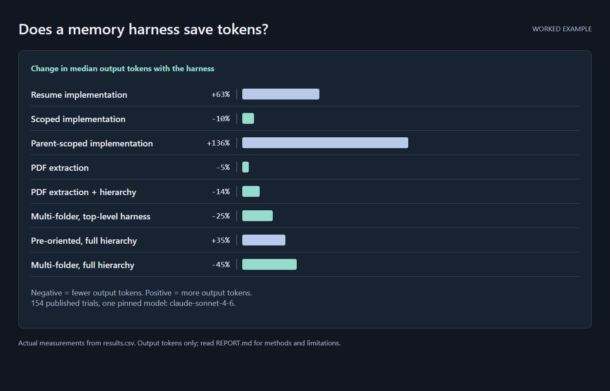

# Does a memory harness make coding agents cheaper? A paired benchmark

**Follow-up study: [PAPER.md](PAPER.md)** tests whether the harness changes the quality of the next real milestone when an agent resumes six real projects (blind judge, both presentation orders, a second judge from another model family). Result: 4 projects lean harness, 1 leans the single-file comparison, 1 is even; not significant (p = 0.375). Data, figures and a replication kit are linked from it.

*Superseded chart, kept as published. It plots the change in median output tokens per task from the first version's output counts, which the corrections below showed were wrong. With complete counts, output differs significantly on only two tasks, in opposite directions: +41% on Task 2B and −10% on Task 1A.*

This repo contains the full write-up and data for a controlled experiment measuring whether a lightweight "memory harness" (persistent `CLAUDE.md` instruction files plus a `CHECKPOINT.md` state file) changes the cost and reliability of LLM coding-agent sessions.

**Design:** 154 paired trials across 8 task types (closed implementation tasks, a half-finished script to complete, and exploratory tasks that require picking the relevant folders out of several), each run with and without the harness under otherwise identical conditions, each in one fresh session. Metrics: API-equivalent cost, tokens counted once per message, peak context and logical decision turns. Significance via two-sided Wilcoxon signed-rank on the paired differences.

**Model:** every trial ran on `claude-sonnet-4-6`, pinned for the full experiment (run in early-to-mid 2026, predating the Claude 5 model family). These results describe that model's behavior on these tasks — they are not a claim about any other model, including newer ones. See [REPORT.md](REPORT.md) § What was tested for the exact pin and § Limitations for what that does and doesn't generalize to.

**Headline result: still no task got cheaper with the harness.** Details and caveats are in [REPORT.md](REPORT.md).

- On trivial tasks, or when the prompt already says where to look, the harness costs 14–31% more. With the harness pre-built on one structured task, it costs 7% more.
- Everywhere else, including the multi-folder exploration tasks the harness was built for, it is roughly cost-neutral (−5% to +6%, not significant).
- The significant token savings don't lower the bill. On Task 3 the harness reads 13% fewer cached tokens but writes 12% more, and cost stays flat.
- Every trial was one fresh session, so the harness's actual purpose, resuming work in a later session, is not tested here.

> **Correction (2026-10-17, restated 2026-10-18).** This README used to say:
>
> - *"Exploratory, orientation-dominated tasks: the harness pays for itself several times over on tokens; a full per-project hierarchy beats a single top-level file."*
> - *"Closed, fully-specified tasks: the harness is a net tax; loading state the task does not need costs tokens with no quality gain."*
> - *"Resume tasks: the state file is the difference between continuing work and re-deriving it."*
>
> The first claim was wrong. The original analysis summed every row of each trial's session log, but Claude Code writes one row per content block and repeats the message's full token usage on each, so most API calls were counted two or three times (cache reads overstated by a median 35%, cache writes by 48%). Recounted once per message and priced at API rates, the exploration tasks are cost-neutral, and a full per-project hierarchy reads less than a single top-level file but costs the same. A second fix on 2026-10-18 took output from each trial's final result record, which holds the complete count; that made one more task (2B) a small loss. The second claim holds in part: trivial and pre-oriented tasks cost more, and the other closed tasks are about neutral. The third was never measured, because no trial resumed earlier work. The old figures stay in [REPORT.md](REPORT.md) as marked "superseded" notes, and the original columns stay in [results.csv](results.csv) beside the corrected ones.

## Files

| File | What it is |
|---|---|
| [REPORT.md](REPORT.md) | The full report: design, methodology, per-task results, statistics, limitations |
| [REPRODUCE.md](REPRODUCE.md) | Step-by-step instructions for re-running the whole thing from scratch |
| [bench/](bench/) | The benchmark itself: trial runner, frozen prompts, verifiers, harness templates, seed data, analyzer |
| [task-specs.md](task-specs.md) | Qualitative spec of each benchmark task and why it exists |
| [takeaways.md](takeaways.md) | Condensed practical guidance derived from the results |
| [results.csv](results.csv) | Per-trial raw results (phase 2, tasks 1-4): the original columns plus six corrected ones (tokens counted once per message, complete output, cost) |

## Reproducing it

The experiment is not just described here, it ships here. [`bench/`](bench/)
holds the actual runner, the eight frozen prompts, the pass/fail verifiers, both
harness templates, the seed data, and the analyzer — the same files that
produced [results.csv](results.csv). [REPRODUCE.md](REPRODUCE.md) walks the run
end to end: prerequisites, a smoke test before you spend money, the `ABBAAB`
pairing sequence, the pre-registered decision rule, the failure modes that
silently corrupt a run, and how to add your own harness variant or task.

Before you rerun: the shipped runner still sums every log row, which is the
counting error described above, so a rerun as shipped reproduces the superseded
token figures. Count each `message.id` once and take output from the session's
final result record; [REPORT.md](REPORT.md) § Reproducing this has the detail.

## Why you might care

If you maintain persistent instruction files for a coding agent (Claude Code, Cursor rules, AGENTS.md, etc.), this is empirical evidence about what that investment costs inside a single session: nothing saved on any task here, and extra spend when the task is trivial or the prompt already orients the agent. It is also a worked example of how a token count taken from agent session logs can go wrong, and how the error was found.

The pattern these trials measure — `CLAUDE.md` for stable rules, `CHECKPOINT.md` for mutable state, hooks that enforce them — is implemented as installable tooling at **[claude-harness-toolbox](https://github.com/dtiger1889-ops/claude-harness-toolbox)**. This repo is the evidence; that repo is the thing the evidence is about. Read [REPORT.md](REPORT.md) § Recommendations before installing it: the honest answer is that it does not make a single session cheaper, and whether it pays off when resuming work across sessions is not tested here.

## License

MIT. See [LICENSE](LICENSE).
